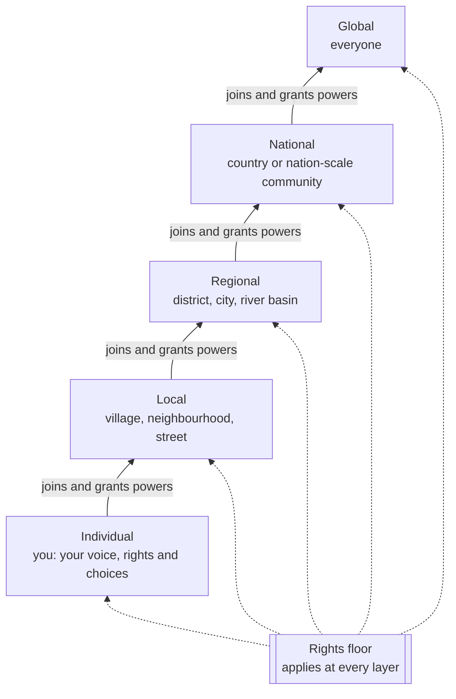

# The Layers of weGov

*Design document, draft 0.1. Open to challenge, see [Open Questions](open-questions.md).*

weGov is built in five nested layers: **individual, local, regional, national and global**. This document explains what each layer is, how power moves between them, and how the design stops the higher layers from taking over the lower ones.

It puts into practice [Manifesto Principle 4, "Power flows from the bottom up"](../MANIFESTO.md#4-power-flows-from-the-bottom-up).

---

## 1. The core rule: power flows upward by consent

Most systems of government are built from the top down. A state exists first and then hands some powers to regions and towns. **weGov works the other way round.**

- Every power starts with **individuals**.
- Individuals form **local** communities and decide together what to handle there.
- Local communities *choose* to join a **regional** layer, and grant it only the powers they agree it needs.
- The same happens again at the **national** and **global** layers.

A higher layer has **only the powers the layers below have granted it**. Those grants are written down, public, limited in time, and **can be taken back**.

There is one exception. The **rights floor**, the rights in [Manifesto Principle 6](../MANIFESTO.md#6-rights-that-no-majority-can-vote-away), applies everywhere and at every layer. No layer can vote it away. Any layer can add stronger protections above it.

---

## 2. The five layers

### Individual

**Who:** You.

**What lives here:**
- your identity and your voice
- your rights and your data
- which communities you belong to
- whether you hand your vote on a topic to someone you trust

The individual is not just "a voter". It is the layer that **owns** all power and lends it out. Everything the higher layers do happens on the individual's behalf.

**Individual powers that can't be taken away:**
- Take part at every layer you belong to.
- Vote directly on anything, overriding any delegate you chose.
- Take back any delegation at any time.
- Leave a community. Joining stays voluntary, though you are still protected by the rights floor.
- See your own data and what the system holds about you.
- Vote in secret.

### Local

**Who:** a community small enough to meet face to face. In practice that is a village, a neighbourhood, a street, a camp or a settlement, roughly up to a few thousand people.

**Typical decisions:** water points, local schools, shared land, markets, settling local disputes, local budgets.

**How decisions are made:** mainly **directly**, through discussion and voting by everyone. This is the layer closest to the Athenian assembly, and the one where weGov must work best on a basic phone and in person.

### Regional

**Who:** a federation of local communities, such as a district, a city, an island or a river basin. A region is defined by the problems its members share, not only by lines on a map.

**Typical decisions:** roads, clinics and hospitals, shared water and energy, transport, and resolving disputes between local communities.

**How decisions are made:** a mix of direct votes on major questions, **mandated delegates** sent from local communities, and **citizens' assemblies** chosen by lottery.

### National

**Who:** a federation of regions at the scale of a nation. It often follows existing countries, but **it does not have to**. A people without a state, a diaspora or a refugee population can also form a national-scale community. weGov does not decide who counts as a nation, and it does not leave stateless people out.

**Typical decisions:** shared rules, large budgets, the community's position on questions brought to the global layer, and engagement with existing governments.

**How decisions are made:** mainly delegates and citizens' assemblies. Direct votes by everyone are used for constitutional-level questions.

### Global

**Who:** everyone, everywhere.

**Typical decisions:**
- The rights floor and this manifesto.
- Truly global commons: the climate, the oceans, the atmosphere, pandemics.
- The rules of the weGov protocol itself.

**How decisions are made:** global citizens' assemblies chosen by lottery to be representative of humanity, and global direct votes on the most fundamental questions.

**The global layer is deliberately the weakest.** It holds the fewest powers, has the strictest limits, and is the easiest to call to account. See section 6.

---

## 3. People belong to many communities at once

Real lives do not fit one neat hierarchy. A person might belong to:

- a village (local), inside a district (regional), inside a country (national)
- a city they work in during the week
- a fishing cooperative spread along a coastline
- a refugee community that crosses borders
- a global climate movement

So weGov has two kinds of community:

- **Communities of place.** These nest geographically through the five layers.
- **Communities of purpose.** These form around an issue, a trade, an identity or a shared resource, at any scale. They can cross borders and layers.

Both use the same tools. A person can belong to many of each. The rule against counting anyone twice applies to **each decision**, not to membership. Within any single vote, you have exactly one voice.

---

## 4. How the layers connect

There are three ways for a layer to make decisions and stay connected to the people below it. Every community chooses its own mix, within the rights floor.

| Method | How it works | Strengths | Risks |
|---|---|---|---|
| **Direct** | Everyone in the community votes | Most equal; nobody stands between you and the decision | Tiring; hard to deliberate in large groups |
| **Mandated delegates** | A community sends a delegate with specific instructions, who reports back and can be recalled at any time | Lets small groups' views travel upward | Delegates can drift from the community and become a new elite |
| **Citizens' assemblies (sortition)** | A randomly selected, representative group studies an issue in depth and makes a recommendation or decision | Deep deliberation; hard to bribe; anyone can be selected | Selected members still need support, translation and protection from pressure |

**Flexible delegation.** As well as the three methods, an individual can hand their vote to someone they trust, **one topic at a time**. For example, a neighbour on water and a nurse on health. They can take the vote back at any moment and can always vote themselves instead. Delegation cannot be passed on endlessly, and nobody may hold more than a capped share of a community's votes (see [Open Questions](open-questions.md)).

**Suggested defaults:** direct at the local layer. Delegates and assemblies at regional and national. Assemblies plus direct votes on fundamentals at global. These are defaults, not rules.

---

## 5. Which layer decides?

Disputes about *who* decides are inevitable. weGov uses two tests.

1. **The affected-people test.** A decision belongs to the smallest community that contains everyone significantly affected by it. A village's water pump is local. A dam on a river that flows through three regions is at least regional, and the people downstream get a voice.
2. **The ability test.** A question moves up a layer only if the lower layer genuinely cannot handle it alone, and only for as long as that remains true.

When two layers disagree about which one decides, the dispute goes to a **jurisdiction assembly**. This is a citizens' assembly drawn by lottery from **both** layers, which rules on that one question. The lower layer wins any tie.

---

## 6. Safeguards against capture at the top

History is clear: **power is captured at the top**. Every safeguard therefore grows stronger the higher the layer.

| Safeguard | Local | Regional | National | Global |
|---|---|---|---|---|
| Powers held | Broad | Granted only | Granted only | Narrowest |
| Majority needed to grant a new power | Simple majority | Majority of members *and* of member communities | Higher threshold | Highest threshold |
| Term of any role | Set by the community | Short | Shorter | Shortest, no renewal |
| Recall | Any time | Any time | Any time | Any time |
| Sunset on granted powers | Optional | Required | Required | Required, short |
| Use of sortition | Optional | Encouraged | Expected | Default |

Further safeguards apply at every layer:

- **The right to leave.** Any community can withdraw from a higher layer, or set up its own copy of the platform under its own control. If a layer is captured, people can walk away and take their records with them.
- **Everything is public.** Every power granted, every decision and every budget is recorded in the tamper-evident public record.
- **No layer controls the software.** Changes to the weGov protocol are global decisions, and no single organisation can push them through on its own authority.

---

## 7. A worked example: a polluted river

1. **Individual:** Amina, a farmer, notices her crops failing and reports it by SMS.
2. **Local:** Her village finds that three other farmers have the same problem. They vote to investigate and to test the water.
3. **Regional:** The tests point to a factory upstream, in a different local community. Both villages are affected, so under the affected-people test the issue belongs to the region. The regional layer sets up a citizens' assembly that includes people from upstream and downstream.
4. **National:** The factory's owner operates in many regions. Regions that face the same problem ask the national layer to adopt a shared water standard, using a power the regions have granted it.
5. **Global:** The river crosses into a neighbouring country. The two national-scale communities take it to the global layer, which holds a narrow, granted power over shared rivers and helps them settle it.

At every step, Amina could follow the decision, vote, or recall the person carrying her community's mandate.

---

## 8. Lessons from history

The idea of nested self-government is old. weGov's contribution is to make it work digitally, for everyone, at every scale.

| Example | What it teaches |
|---|---|
| **Swiss communes and cantons** | Direct democracy at several layers can last for well over a century |
| **Participatory budgeting, Porto Alegre** | Neighbourhood assemblies feeding into city decisions over real money works, and spreads |
| **Panchayati Raj, India** | Village, block and district councils can reach hundreds of millions of people |
| **Zapatista and Rojava councils** | Communes can federate upward with delegates who can be recalled |
| **The early soviets, 1917** | Bottom-up councils can be captured from the top. Safeguards have to point upward |
| **Ireland's citizens' assemblies** | Randomly selected citizens can settle deeply divisive questions |

---

## 9. Questions this document has not answered

The open questions about the layers are kept in the [Open Questions register](open-questions.md#layers). They include delegation caps, how regions form, the relationship to existing states, and how communities of purpose get a voice at higher layers.

**This document is meant to be challenged.** If you think something here is wrong, see [CONTRIBUTING](../CONTRIBUTING.md).
