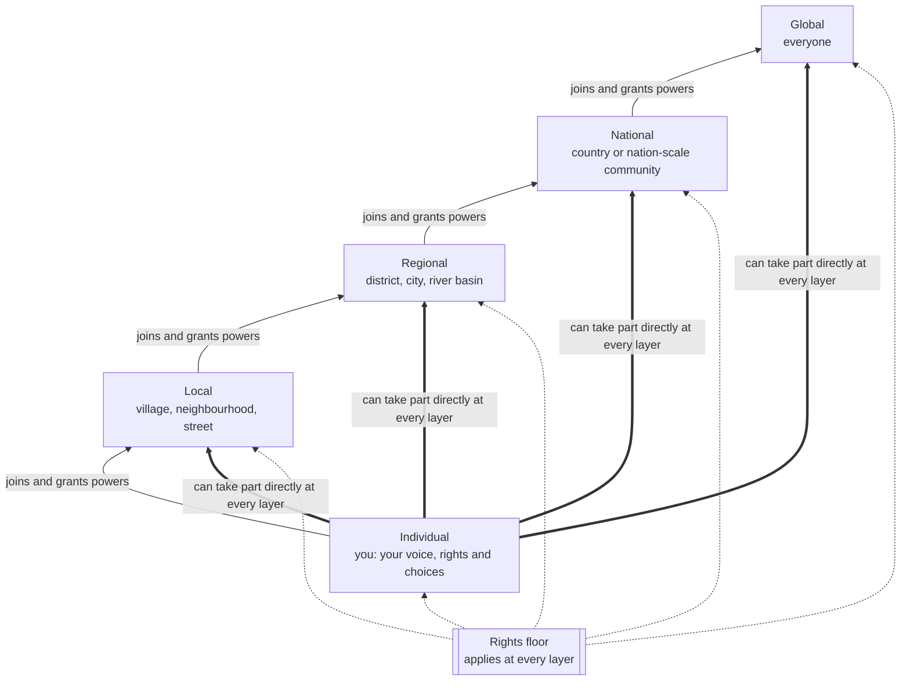

# The Layers of weGov

*Design document, draft 0.2. Open to challenge, see [Open Questions](open-questions.md).*

weGov is built in five nested layers: **individual, local, regional, national and global**. This document explains what each layer is, how decisions are made at each one, and how the design stops the higher layers from taking over the lower ones.

It puts into practice [Manifesto Principle 1, "Every person has an equal voice, in every decision"](../MANIFESTO.md#1-every-person-has-an-equal-voice-in-every-decision) and [Principle 4, "Power flows from the bottom up"](../MANIFESTO.md#4-power-flows-from-the-bottom-up).

---

## 1. The two core rules

### Rule 1: The open door. Everyone can take part in everything.

**Every person can take part in every decision that affects them, at every layer.** That covers a decision about their street and a decision about the whole planet alike. Taking part means being able to:

- **see** every proposal, discussion, budget and decision
- **speak** by commenting, questioning or objecting
- **propose** new ideas and changes to existing proposals
- **vote**

Nothing in weGov can close this door. That includes delegates, citizens' assemblies, committees, majorities and the software itself. It is part of the rights floor.

**You choose how involved you are** (see section 4). Some people will vote on everything. Most will follow what matters to them and trust others on the rest. Some will only step in when something touches their life. All of these are equally valid, and **you can change your choice at any moment, on any decision**.

This is what makes weGov different from representative government. In a representative system you hand over your voice for years at a time. In weGov you never hand it over. At most you lend it, one topic at a time, and you can always take it back.

### Rule 2: Power flows upward by consent.

Most systems of government are built from the top down. A state exists first and then hands some powers to regions and towns. **weGov works the other way round.**

- Every power starts with **individuals**.
- Individuals form **local** communities and decide together what to handle there.
- Local communities *choose* to join a **regional** layer, and grant it only the powers they agree it needs.
- The same happens again at the **national** and **global** layers.

A higher layer has **only the powers the layers below have granted it**. Those grants are written down, public, limited in time, and **can be taken back**.

The **rights floor**, the rights in [Manifesto Principle 6](../MANIFESTO.md#6-rights-that-no-majority-can-vote-away), applies everywhere and at every layer. No layer can vote it away. The open door (Rule 1) is part of it. Any layer can add stronger protections above it.

---

## 2. The five layers

At **every** layer, every member can see, speak on, propose and vote on every decision (Rule 1). What changes between layers is the scale, the kind of decisions, and the tools that help people make them well.

### Individual

**Who:** You.

**What lives here:**
- your identity and your voice
- your rights and your data
- which communities you belong to
- how involved you want to be in each one, and on each topic

The individual is not just "a voter". It is the layer that **owns** all power and lends it out. Everything the higher layers do happens on the individual's behalf.

**Individual powers that can't be taken away:**
- Take part in **any decision at any layer you belong to**, from your street to the whole world.
- Vote directly on anything, overriding any delegate you chose, right up until voting closes.
- Take back any delegation at any time.
- Leave a community. Joining stays voluntary, though you are still protected by the rights floor.
- See your own data and what the system holds about you.
- Vote in secret.

### Local

**Who:** a community small enough to meet face to face. In practice that is a village, a neighbourhood, a street, a camp or a settlement, roughly up to a few thousand people.

**Typical decisions:** water points, local schools, shared land, markets, settling local disputes, local budgets.

**How decisions are made:** discussion and voting by members, online, by SMS or voice, and in person. This is the layer closest to the Athenian assembly, and the one where weGov must work best on a basic phone and face to face.

### Regional

**Who:** a federation of local communities, such as a district, a city, an island or a river basin. A region is defined by the problems its members share, not only by lines on a map.

**Typical decisions:** roads, clinics and hospitals, shared water and energy, transport, and resolving disputes between local communities.

**How decisions are made:** every member of the region can take part and vote. Local communities can also send **mandated delegates** to help shape proposals, and **citizens' assemblies** chosen by lottery can study complex questions in depth. Delegates and assemblies help prepare decisions. They never shut out anyone who wants a say.

### National

**Who:** a federation of regions at the scale of a nation. It often follows existing countries, but **it does not have to**. A people without a state, a diaspora or a refugee population can also form a national-scale community. weGov does not decide who counts as a nation, and it does not leave stateless people out.

**Typical decisions:** shared rules, large budgets, the community's position on questions brought to the global layer, and engagement with existing governments.

**How decisions are made:** as at the regional layer, every member can take part and vote. Discussion happens in many small groups whose results are combined, so millions of people can deliberate rather than just shout. Citizens' assemblies and delegates help prepare the proposals.

### Global

**Who:** everyone, everywhere.

**Typical decisions:**
- The rights floor and this manifesto.
- Truly global commons: the climate, the oceans, the atmosphere, pandemics.
- The rules of the weGov protocol itself.

**How decisions are made:** every person on Earth can take part. Global citizens' assemblies, chosen by lottery to be representative of humanity, prepare clear proposals in every language. The voting window is long enough for people everywhere to take part, including offline and by SMS or voice.

**The global layer is deliberately the weakest.** It holds the fewest powers, has the strictest limits, and is the easiest to call to account. See section 7.

---

## 3. People belong to many communities at once

Real lives do not fit one neat hierarchy. A person might belong to:

- a village (local), inside a district (regional), inside a country (national)
- a city they work in during the week
- a fishing cooperative spread along a coastline
- a refugee community that crosses borders
- a global climate movement

So weGov has two kinds of community:

- **Communities of place.** These nest geographically through the five layers.
- **Communities of purpose.** These form around an issue, a trade, an identity or a shared resource, at any scale. They can cross borders and layers.

Both use the same tools. A person can belong to many of each. The rule against counting anyone twice applies to **each decision**, not to membership. Within any single vote, you have exactly one voice.

---

## 4. Choose your involvement

Everyone has the same right to take part in everything. What differs is how much each person **wants** to. weGov treats involvement as a dial that each person sets for themselves, and can set differently for each community, topic or decision.

| Setting | What it means |
|---|---|
| **Active** | You are told about decisions and you vote yourself |
| **Trusted** | On a topic you choose, someone you trust votes for you. You see how they voted, and you can override them on any single decision or take your trust back at any time |
| **Following** | You get plain-language updates and can step in whenever you want, but you don't vote unless you choose to |
| **Quiet** | You only hear about decisions that directly affect you, such as your water, your land or your safety |

Whatever your setting, **the door stays open**. You can always jump into any decision, at any layer, right up until voting closes.

### The tools that help people decide well

Taking part in everything is a right. But nobody can study every question in the world. These tools exist to **help** the many decide well. They never **replace** the many.

| Tool | What it does | What it can never do |
|---|---|---|
| **Trusted delegates** | Vote on your behalf on topics you choose, with full transparency | Hold your vote on any decision where you vote yourself; keep your trust after you take it back |
| **Mandated community delegates** | Carry a community's views upward to help shape proposals at a higher layer; report back; can be recalled | Make a final decision that members were shut out of |
| **Citizens' assemblies (sortition)** | A randomly selected, representative group studies a question in depth, hears evidence and writes a clear recommendation | Stop a proposal reaching everyone, or decide anything that everyone hasn't had the chance to vote on |
| **Plain-language summaries** | Every proposal comes with a short, neutral explanation in every language, as text, audio and pictures | Push people towards one answer |

**Limits on trust:** nobody may hold more than a capped share of any community's trusted votes, and trust cannot be passed along endlessly. The exact limits are still open questions (see [L-03](open-questions.md#layers)).

### When is a decision valid?

Because everyone can take part, decisions need enough people involved to count as truly shared. Every decision has:

- **A fair window of time.** Voting stays open long enough for people offline, on basic phones, working long hours or far away to take part. Bigger layers get longer windows.
- **A minimum turnout.** Enough people must take part, counting both direct votes and trusted votes, or the decision is not valid.
- **Stronger majorities for bigger changes.** Granting new powers to a higher layer, or changing a community's own rules, needs more than a simple majority.

---

## 5. Which layer decides?

Disputes about *which* layer a question belongs to are inevitable. Whichever layer it is, everyone affected can still take part. weGov uses two tests.

1. **The affected-people test.** A decision belongs to the smallest community that contains everyone significantly affected by it. A village's water pump is local. A dam on a river that flows through three regions is at least regional, and the people downstream get a voice.
2. **The ability test.** A question moves up a layer only if the lower layer genuinely cannot handle it alone, and only for as long as that remains true.

When two layers disagree about which one decides, the dispute goes to a **jurisdiction assembly**. This is a citizens' assembly drawn by lottery from **both** layers, which recommends an answer to that one question. The members of both layers then confirm it. The lower layer wins any tie.

---

## 6. Making "everyone, everything" work at scale

Letting billions of people take part in everything is the hardest part of this design, and the part that matters most. These are the main ways weGov makes it possible.

- **You hear about what affects you.** You aren't flooded with every decision in the world. You're told about the ones that touch your communities, your topics and your life, at the involvement level you chose.
- **Plain language, every language, every channel.** Every proposal is summarised as text, audio and pictures, and reaches people by app, web, SMS, voice call, radio and in-person meetings.
- **Small-group discussion, combined.** Large layers don't hold one giant debate. They hold thousands of small conversations, locally and online, and combine what they find, showing where people agree as well as where they differ.
- **Trust that is lent, never given away.** Trusted delegation lets people who are busy, unsure or uninterested still be represented by someone *they* chose, while keeping the right to step in.
- **Time.** No rushed votes. Long windows, reminders, and the ability to vote on paper or in person where phones don't reach.

The risk weGov must guard against most is **participation fatigue**: people overwhelmed and drifting away, leaving decisions to a small, active few. Designing against that is an open question ([L-10](open-questions.md#layers)).

---

## 7. Safeguards against capture at the top

History is clear: **power is captured at the top**. Every safeguard therefore grows stronger the higher the layer.

| Safeguard | Local | Regional | National | Global |
|---|---|---|---|---|
| Open to every member to take part and vote | Always | Always | Always | Always |
| Powers held | Broad | Granted only | Granted only | Narrowest |
| Majority needed to grant a new power | Simple majority | Majority of members *and* of member communities | Higher threshold | Highest threshold |
| Term of any role | Set by the community | Short | Shorter | Shortest, no renewal |
| Recall | Any time | Any time | Any time | Any time |
| Sunset on granted powers | Optional | Required | Required | Required, short |
| Citizens' assemblies to prepare proposals | Optional | Encouraged | Expected | Default |

Further safeguards apply at every layer:

- **The right to leave.** Any community can withdraw from a higher layer, or set up its own copy of the platform under its own control. If a layer is captured, people can walk away and take their records with them.
- **Everything is public.** Every power granted, every decision and every budget is recorded in the tamper-evident public record.
- **No layer controls the software.** Changes to the weGov protocol are global decisions, open to everyone, and no single organisation can push them through on its own authority.

---

## 8. A worked example: a polluted river

1. **Individual:** Amina, a farmer, notices her crops failing and reports it by SMS.
2. **Local:** Her village finds that three other farmers have the same problem. They vote to investigate and to test the water.
3. **Regional:** The tests point to a factory upstream, in a different local community. Both villages are affected, so under the affected-people test the issue belongs to the region. A citizens' assembly that includes people from upstream and downstream studies the evidence and drafts options. **Every member of the region**, including Amina, can comment and vote on them.
4. **National:** The factory's owner operates in many regions. Those regions propose a shared national water standard. Amina hasn't followed national politics before. She is notified because the standard affects her land, and she votes on it by SMS.
5. **Global:** The river crosses into a neighbouring country. The two national-scale communities take it to the global layer, which holds a narrow, granted power over shared rivers. Anyone in the world can see the proposal and vote. Amina does, alongside farmers downstream in the other country.

At every step, Amina had a chance to have her say. She took part directly whenever she wanted, and at other times relied on people she trusted.

---

## 9. Lessons from history

The idea of nested self-government is old. weGov's contribution is to open **every** layer to **every** person, digitally and on any phone.

| Example | What it teaches |
|---|---|
| **Swiss communes and cantons** | Direct democracy at several layers can last for well over a century |
| **Participatory budgeting, Porto Alegre** | Neighbourhood assemblies feeding into city decisions over real money works, and spreads |
| **Panchayati Raj, India** | Village, block and district councils can reach hundreds of millions of people |
| **Zapatista and Rojava councils** | Communes can federate upward with delegates who can be recalled |
| **The early soviets, 1917** | Bottom-up councils can be captured from the top when ordinary people lose their direct say at higher levels. This is why the open door matters |
| **Ireland's citizens' assemblies** | Randomly selected citizens can prepare deeply divisive questions well, and the whole public then decided them in referendums |

---

## 10. Questions this document has not answered

The open questions about the layers are kept in the [Open Questions register](open-questions.md#layers). They include participation fatigue, minimum turnout, limits on trusted delegation, how regions form, the relationship to existing states, and how communities of purpose get a voice at higher layers.

**This document is meant to be challenged.** If you think something here is wrong, see [CONTRIBUTING](../CONTRIBUTING.md).
